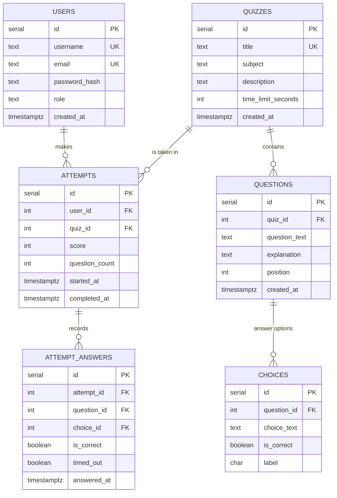

# QuizWhiz — Project Specification & Development Plan

**Project:** QuizWhiz — a quiz web app for a high school AI-assisted web development course
**App name:** QuizWhiz (the GitHub repo keeps its original name, `quizzly`)
**Status:** Planning / specification — no code written yet
**Repo:** github.com/bribrielleelle/quizzly

---

## 1. Overview

QuizWhiz is a quiz application where **players** take multiple-choice quizzes and track their progress, and **teachers/admins** manage quiz content. The app is built with plain HTML/CSS/JavaScript on the frontend, an Express 5 API on Node.js 24 LTS, and Replit PostgreSQL for storage. The Replit workspace is the QA environment; Replit Deployment is production with its own database.

**The five built-in quizzes (school subjects):**

1. Math
2. Science
3. History
4. Geography
5. English

Each quiz ships with at least **10 questions**, each with exactly **4 answer choices** and **exactly one correct answer**.

---

## 2. Confirmed Design Decisions

| # | Decision | Choice | Rationale |
|---|----------|--------|-----------|
| D1 | Quiz topics | Math, Science, History, Geography, English | User's choice; matches the course context |
| D2 | Additional feature #1 | **Timed quiz mode** — per-question countdown | Functional, not cosmetic; adds game feel |
| D3 | Additional feature #2 | **Answer explanations** shown after each question | Functional; uses a new data field + UI flow |
| D4 | Teacher account creation | **Secret invite code** at registration (code stored as a server-side secret) | Simple, avoids building an admin approval UI, keeps sign-up self-service |
| D5 | Password storage | **bcryptjs** hashes (cost 10) | Pure-JS bcrypt avoids native build issues on Replit; satisfies "never plain text" |
| D6 | Session handling | Signed **cookie session** (`cookie-session`), httpOnly, sameSite=lax | No server-side session table needed; survives restarts |
| D7 | Unfinished attempts | Attempt row created at start with `completed_at = NULL`; only rows with `completed_at` count as completions | Cleanly satisfies "unfinished attempts do not count" everywhere with one rule |
| D8 | Grading | Server-side grading only (client never sees which choice is correct until after answering) | Prevents cheating via devtools |
| D9 | Roles | Two roles: `player` and `teacher` (teacher = admin, one role) | Matches requirements; keeps permissions model simple |
| D10 | Timer enforcement | Server records when each question is presented; answers after the deadline are marked as timeouts (incorrect) | Client countdown is UX only; the server is the source of truth |
| D11 | App name & brand | **QuizWhiz** 🌟 — repo stays `quizzly` | User's choice; friendly for classmates |
| D12 | Audience & mood | High school classmates; cozy, friendly, warm | User's choice; shapes the whole theme |
| D13 | Visual theme | Modern flat: cream background, coral/peach primary, warm brown text; Nunito + Open Sans; rounded cards, soft shadows, light emoji accents | User's choice (see §10 for the full theme) |
| D14 | Timed mode defaults | 30 s per question (teacher sets 15–90 s per quiz); timeout = incorrect, correct answer + explanation flash, auto-advance | User's choice |
| D15 | Explanations timing | Shown after **every** question, right or wrong | User's choice |
| D16 | Per-quiz leaderboard tie-break | Highest score desc → fewer completed attempts asc → earliest best-score completion asc → username A–Z | User's choice; fully deterministic for testing |
| D17 | Overall leaderboard tie-break | Total completed attempts desc → more total correct answers desc → username A–Z | User's choice |
| D18 | Leaderboard display & location | Top 10 + pinned "your rank" row; one Leaderboards page with an Overall tab + one tab per quiz | User's choice |

---

## 3. User Roles & Permissions

| Capability | Player | Teacher/Admin |
|---|---|---|
| Register / log in / log out | ✅ | ✅ |
| Take a quiz, see score & percentage, retry | ✅ | ✅ |
| View own attempt history | ✅ | ✅ |
| View leaderboards | ✅ | ✅ |
| Add / edit questions, choices, correct answers, explanations | ❌ | ✅ |
| Assign questions to quizzes | ✅ | ❌ |
| Upload questions via CSV with preview/validation | ❌ | ✅ |
| See other users' emails | ❌ | ❌ (leaderboards show usernames only) |

**Teacher registration (D4):** the registration form has an optional "Invite code" field. If the field matches the `TEACHER_INVITE_CODE` secret, the account is created with the `teacher` role; otherwise `player`. The code lives only in Replit Secrets (per environment), never in the repo.

**Enforcement:** every API route checks authentication; teacher-only routes use a `requireTeacher` middleware. The frontend hides teacher controls from players, but the **server** is what actually blocks access.

---

## 4. Functional Specification

### 4.1 Authentication & Accounts

- **Register** with username, email, password (+ optional invite code).
  - Username is unique and is the only name shown on leaderboards.
  - Email is unique and used only for login identity; never displayed publicly.
  - Passwords hashed with bcryptjs **before** storage; plain-text passwords are never logged or stored.
- **Log in** with email + password → sets a signed session cookie.
- **Log out** clears the session cookie.
- **Session:** a logged-in user stays logged in across page reloads and app restarts.

### 4.2 Quiz Catalog

- Home page lists the five quizzes with title, subject, question count, and best score (if the user has one).
- Clicking a quiz opens a detail page with a description, question count, and **Start** button.

### 4.3 Taking a Quiz (incl. the two additional features)

1. Player starts a quiz → an attempt row is created (`completed_at = NULL`, per D7).
2. Questions are shown **one at a time**, in order. Each shows the question text, exactly 4 choices, and a countdown timer.
3. Player selects a choice → the answer is graded **on the server**.
4. **Additional feature #1 — Timed mode:** each question has a per-question time limit (default 30 seconds; teacher can set 15–90 s per quiz). If the countdown hits zero, the question is recorded as a **timeout (incorrect)**, the correct answer and explanation flash as feedback, and the quiz **auto-advances** to the next question. The server compares the submit time against the time it served the question, so a tampered client timer doesn't help.
5. **Additional feature #2 — Explanations:** after answering, the app reveals whether the answer was correct, **which choice was the correct one**, and the question's **explanation text** (if the teacher wrote one). Then the player continues to the next question.
6. When the last question is answered, the attempt is completed (`completed_at` set).
7. A player can abandon a quiz at any point; the attempt simply stays unfinished and never counts as a completion.

### 4.4 Scoring & Results

- **Score** = number of correct answers.
- **Percentage correct** = `score / question_count × 100`, rounded to the nearest whole percent.
- Results page shows score, percentage, and a **Retry** button that starts a fresh attempt of the same quiz.

### 4.5 Attempt History

- Every completed attempt — **including retries** — is saved as its own row.
- Each attempt records: user, quiz, score, question count, completion date/time.
- The player's history page lists their attempts, newest first, with quiz name, score, question count, and completion timestamp.
- Unfinished attempts are **not** listed as completions in history, counts, or leaderboards (per D7).

### 4.6 Leaderboards (precise rules)

**General rules (both boards)**

- **G1 — Usernames only.** Every leaderboard displays usernames; email addresses never appear.
- **G2 — Completed only.** Only attempts with `completed_at` set count anywhere. Unfinished attempts (including abandoned ones) never affect ranking, counts, or displays (per D7).
- **G3 — Retries always saved.** Every completed attempt, including retries, is its own row; boards are always computed live from the attempts table, never cached or overwritten.
- **G4 — Everyone eligible.** Any user with at least one completed attempt appears; users with zero completed attempts are not ranked.
- **G5 — Display.** Top 10 rows, plus a pinned row beneath the table showing **your** rank ("You — rank 14 of 22 · 3 attempts"). If you're inside the top 10, your row is highlighted instead.
- **G6 — Location.** One **Leaderboards** page with tabs: **Overall** + one tab per quiz (Math, Science, History, Geography, English). Default tab: Overall.

**Overall leaderboard (per D17)**

- **Metric:** total completed quiz attempts across **all** quizzes (most first).
- **Ordering:** total completed attempts **desc** → total correct answers across all completed attempts **desc** → username **A–Z**.
- **Columns:** Rank · Username · Total attempts (total correct answers shown as small secondary text, which makes the tie-break visible).

**Per-quiz leaderboard (per D16)**

- **Metric:** each user's **highest score** among completed attempts of that quiz.
- **Ordering:** highest score **desc** → completed attempts **asc** (fewer attempts wins = efficiency) → earliest completion of that best score **asc** → username **A–Z**.
- **Columns:** Rank · Username · Best score (as `X/10`) · Completed attempts.

**Retry & score semantics**

- A user's best score can only **stay or rise** (highest score is a MAX, never lowered by a bad retry).
- Every retry increments the "completed attempts" count on both boards.
- The results page compares the new score to the player's previous best and shows a "New personal best!" badge when it's beaten.

**Edge cases (testable)**

- Two users, same best score, same attempt count → earlier best-score completion ranks higher; still tied → alphabetical username.
- User with only unfinished attempts → not on any board; their pinned row shows "Not ranked yet — complete a quiz!"
- Quiz edited to add/remove questions → past attempts keep their frozen `question_count` and `score`; best scores stay comparable only within their quiz, and the board still ranks by score as recorded.

### 4.7 Teacher/Admin Question Editor

Teacher-only pages let the teacher:

- Pick a quiz and view all of its questions with choices, correct answers, and explanations.
- **Add** a question: text, 4 choices, mark exactly one choice as correct, optional explanation, set the quiz's per-question time limit.
- **Edit** an existing question: change text, any choice, the correct answer, or the explanation.
- **Delete** a question (a quiz must keep ≥ 10 questions to remain playable; deleting below 10 is blocked).
- **Assign** uploaded or newly created questions to a quiz (questions belong to exactly one quiz).

### 4.8 CSV Question Upload (template, preview, validation)

**Standard CSV template** (also downloadable from the teacher page as `questions-template.csv`):

```csv
question_text,choice_a,choice_b,choice_c,choice_d,correct_choice,explanation
What is 7 x 8?,54,56,58,54.0,B,7x8 comes from doubling 7x4
```

**Column rules**

| Column | Rule |
|---|---|
| `question_text` | Required, non-empty |
| `choice_a` … `choice_d` | Required, all four non-empty; must not all be identical |
| `correct_choice` | Required; must be exactly one of `A`, `B`, `C`, `D` (case-insensitive) |
| `explanation` | Optional; may be empty |

**Upload flow (three steps, mandatory):**

1. **Upload** — teacher picks a CSV file for a target quiz.
2. **Preview & validate** — the server parses the file and shows a table of every parsed row with its data, plus a clear error list identifying **each invalid row by row number and reason** (e.g., "Row 4: correct_choice must be A–D"). **Nothing is written to the database yet.** Rows containing the template header row are ignored gracefully.
3. **Import** — only if the teacher confirms. Invalid rows are **skipped** (with the reasons repeated in the result summary), or the teacher can go back and fix the file. The result summary states how many questions were imported and how many were skipped.

---

## 5. Data Model



**Table notes**

- `users.password_hash` — bcryptjs hash, never plain text.
- `users.role` — `'player'` | `'teacher'`.
- `quizzes.time_limit_seconds` — per-question time limit for **Additional feature #1** (default 30).
- `questions.explanation` — supports **Additional feature #2**; nullable.
- `choices.label` — `'A'`|`'B'`|`'C'`|`'D'`; exactly one row per question has `is_correct = true` (enforced by app logic + a partial unique index where possible).
- `attempts.score` / `question_count` — frozen at completion time so later question edits don't rewrite history.
- `attempts.completed_at` — `NULL` while in progress; **the single source of truth for "completed"** (D7).
- `attempt_answers` — one row per answered question; supports grading, timeouts, and the explanations flow. Unfinished attempts keep their answer rows but are excluded from completions.

**Persistence requirement:** all data above lives in PostgreSQL and survives app restarts (no in-memory-only storage).

---

## 6. API Design (single Express server serves these + static files)

| Method & Path | Access | Purpose |
|---|---|---|
| `POST /api/auth/register` | Public | Create account (invite code → teacher role) |
| `POST /api/auth/login` | Public | Log in, set session cookie |
| `POST /api/auth/logout` | Logged in | Clear session |
| `GET /api/auth/me` | Logged in | Current user (id, username, role) |
| `GET /api/quizzes` | Logged in | Quiz list with question counts |
| `GET /api/quizzes/:id` | Logged in | Quiz detail |
| `POST /api/quizzes/:id/attempts` | Player/teacher | Start attempt → attempt id + first question |
| `POST /api/attempts/:id/answers` | Attempt owner | Submit one answer → correct?, correct choice, explanation |
| `POST /api/attempts/:id/complete` | Attempt owner | Finish attempt → score, percentage |
| `GET /api/me/attempts` | Logged in | Own completed attempt history |
| `GET /api/leaderboard/overall` | Logged in | Overall leaderboard |
| `GET /api/quizzes/:id/leaderboard` | Logged in | Per-quiz leaderboard |
| `GET /api/quizzes/:id/questions` | Teacher | Full question list incl. correct answers |
| `POST /api/quizzes/:id/questions` | Teacher | Create question (text, 4 choices, correct, explanation) |
| `PATCH /api/questions/:id` | Teacher | Edit question / choices / correct answer / explanation |
| `DELETE /api/questions/:id` | Teacher | Delete question (blocked if quiz would drop below 10) |
| `GET /api/quizzes/:id/import/template` | Teacher | Download CSV template |
| `POST /api/quizzes/:id/import/preview` | Teacher | Parse + validate CSV, return rows + per-row errors (no DB write) |
| `POST /api/quizzes/:id/import` | Teacher | Import validated rows; report imported/skipped counts |

Conventions: JSON responses; errors as `{ error: "message" }`; 401 for unauthenticated, 403 for wrong role; all SQL parameterized via `pg`.

---

## 7. Security & Data Rules

1. **Passwords:** bcryptjs hash (cost 10) at registration; login compares hashes. Plain-text passwords are never stored, logged, or returned by any API.
2. **SQL:** every query uses `pg` parameterized placeholders (`$1`, `$2`, …). No string-concatenated SQL.
3. **Sessions:** signed httpOnly cookie (`cookie-session`); `sameSite=lax`; secret stored in Replit Secrets per environment.
4. **Authorization:** server-side checks on every protected route (`requireAuth`, `requireTeacher`, attempt-ownership checks). Players cannot reach teacher APIs even with direct requests.
5. **Answer secrecy:** correct-answer flags are only sent **after** a question is answered.
6. **Public identity:** leaderboards and history render usernames only; emails never appear in any public list.
7. **Secrets:** `DATABASE_URL`, `SESSION_SECRET`, `TEACHER_INVITE_CODE` live in Replit Secrets (workspace and deployment each have their own values); never committed to GitHub.
8. **Escaping:** all user-supplied content rendered as text nodes (via `textContent`), not injected as raw HTML, to prevent XSS.

---

## 8. Tech Stack

| Layer | Technology |
|---|---|
| Frontend | Plain HTML, CSS, JavaScript (no frontend framework) |
| Server | Node.js 24 LTS, Express 5 — serves static files **and** API routes from one server |
| Package manager | npm, `package-lock.json` committed |
| Database | Replit PostgreSQL (separate dev/QA + production instances) |
| DB access | `pg` with parameterized SQL only |
| AI dev environment | Mistral Code (used to assist, not replace, understanding — see §13) |
| Version control | GitHub — code, docs, and development history |
| QA environment | Replit development workspace |
| Production | Replit Deployment with its own PostgreSQL database |

---

## 9. Environments & Deployment

- **QA = Replit workspace.** Develop, run, and test here against the workspace PostgreSQL database. Do not merge work that hasn't been tested in QA.
- **Production = Replit Deployment.** Deployed app connects to a **separate production database** via its own `DATABASE_URL` secret. Schema is applied to the production DB with the same migration script; seed content is loaded once (or via CSV import) so the five quizzes exist in production.
- **Consistency:** the same Node/Express/pg versions and same code run in both environments. Only secrets differ.
- **Persistence check (required):** after deploying, add a user, complete a quiz, and confirm data still exists after an app **restart**.

---

## 10. Visual Theme & Brand

**Brand**

- Name: **QuizWhiz** 🌟 — Tagline: *"Five subjects. Ten questions. How smart are your classmates?"*
- Mood: cozy, friendly, warm — a study corner, not a stadium. Modern flat design: rounded cards, soft shadows, clean icons, generous breathing room.

**Color palette**

| Role | Color | Hex |
|---|---|---|
| Page background | Cream | `#FFF8EF` |
| Cards / panels | White on cream | `#FFFFFF` |
| Primary (buttons, links, active tabs) | Coral | `#FF7A5C` |
| Primary hover | Peach | `#FF9477` |
| Headings & body text | Warm brown | `#4A3B32` |
| Secondary / muted text | Soft taupe | `#8A7A6E` |
| Correct feedback | Sage green | `#6BBF8A` (tint `#E6F4EB`) |
| Incorrect feedback | Soft red | `#F28B82` (tint `#FDECEA`) |
| Timer warning (< 10 s) | Amber | `#FFB35C` |

*Contrast rule:* white text on coral must meet AA contrast; if it doesn't in practice, darken button coral to `#F0633F`. Color is never the only signal — pair colors with ✓ / ✗ / ⏰ icons.

**Typography**

- Headings: **Nunito** 700–800 · Body: **Open Sans** 400/600.
- Sizes: body 16px · question text 20px · H1 32px · H2 24px · labels/small 14px.

**Shape, spacing, style**

- Corner radius: 16px cards, 12px buttons/inputs.
- Soft shadows: `0 2px 8px rgba(74,59,50,0.10)`.
- Content column max-width 960px, centered; card padding 24px; 8px spacing scale; ≥ 44px touch targets.

**Emoji accents (light, purposeful)**

- Subject icons on quiz cards: 🧮 Math · 🔬 Science · 📜 History · 🌍 Geography · 📚 English.
- 🎉 celebration on results ≥ 80% · 🌟 on top-3 leaderboard rows · ⏱ next to the timer.
- Never inside body copy, error messages, or form labels — feedback stays clear and readable.

**Feedback color behavior**

- Correct answer → sage banner + tinted choice. Incorrect → soft-red banner, wrong choice tinted, correct choice outlined in sage.
- Timer bar: coral → amber under 10 s → soft red under 5 s.

---

## 11. UX Flows & Navigation

**Global navigation bar (top, sticky, on every page)**

- Left: **QuizWhiz** logo (wordmark) → links to Home.
- Logged out: right side → **Log in** (secondary button) · **Sign up** (primary button).
- Logged in (player): **Home** · **Leaderboards** · **My History** · username chip · **Log out**.
- Logged in (teacher): adds a **Teacher** link between My History and the username chip.

### A. New player walkthrough

1. **Home (logged out):** hero with app name, tagline, three feature blurbs (5 subjects · timed mode · leaderboards), and "Create account" + "Log in" buttons.
2. **Register:** username, email, password, confirm password, optional invite code ("Have a class code?"). Inline validation under each field ("That username is taken — try another."). Submit → auto-logged in → Home.
3. **Home (logged in):** greeting ("Hi, Alex! 🌟"), grid of five quiz cards — subject emoji, title, "10 questions · 30 s each", personal best ("—" if none), **Play** button.
4. **Quiz detail:** description, stat chips (10 questions · 30 s/question · your best), top-3 leaderboard preview, **Start quiz** (primary) + **Back**.
5. **Quiz play:** "Question 3 of 10" + timer bar; question text; four choice buttons labeled A–D. **One tap = answer** (no separate confirm step, since the clock is running).
6. **Feedback state:** banner — *Correct! ✓* / *Not quite ✗* / *Time's up ⏰*; the correct choice is highlighted; explanation card shows ("Why? …") if one exists; **Next question** button (after a timeout, the flow auto-advances after the flash).
7. **Results:** reaction emoji (🎉 ≥ 80%, 🙂 ≥ 50%, 💪 below), big score "8/10", percentage, "New personal best!" badge if earned; buttons: **Retry** (primary), **View leaderboard**, **Back to quizzes**; link to My History.
8. **My History:** table of all completed attempts, newest first, each row with a **Retake** button.

### B. Returning player walkthrough

- Logs in → Home already shows personal bests; jumps straight to a quiz, Leaderboards, or My History.
- **Leaderboards:** tabs (Overall + five quizzes); their own rank pinned below each board, own row highlighted.
- **My History:** full list including every retry, with scores and completion times.
- **Retrying:** quiz detail shows "Personal best: 8/10 · 3 attempts"; after finishing, the results page compares the new score to the previous best.
- **Abandoning:** closing the page mid-quiz leaves the attempt unfinished — it never counts, and there is no resume; starting again creates a fresh attempt.

### C. Teacher/admin walkthrough

- Registers with the invite code → **Teacher** appears in the nav.
1. **Teacher dashboard:** five quiz rows with question counts; a warning badge on any quiz with fewer than 10 questions; per quiz: **Edit questions** · **Import CSV** · **Settings** (description + per-question time limit, 15–90 s).
2. **Question editor:** question cards numbered in order, each showing text, four choices (correct one marked ✓ with sage tint), explanation; **Add question** at top; **Edit** / **Delete** per card (delete blocked below 10 questions, with a clear message).
3. **Add/Edit form:** question text, choices A–D, radio buttons for "correct" (exactly one required), explanation textarea; **Save** / **Cancel**.
4. **CSV import:** quiz selector, "Download template" link, file picker, **Preview** button → preview table where invalid rows are highlighted with row number + reason; **Import N questions** button (only after preview) + **Cancel**; result summary: "8 imported, 2 skipped" with the skip reasons repeated.

**Buttons & links per screen (summary)**

| Screen | Primary action | Secondary actions |
|---|---|---|
| Welcome | Create account | Log in |
| Home | Play (per quiz card) | Leaderboards, My History (nav) |
| Quiz detail | Start quiz | Back, leaderboard preview |
| Quiz play | Tap choice | (Next question appears after feedback) |
| Results | Retry | View leaderboard, Back to quizzes |
| My History | Retake (per row) | Home |
| Leaderboards | Switch tabs | Home, pick quiz from tab |
| Teacher dashboard | Edit questions | Import CSV, Settings |
| Question editor | Add question | Edit, Delete (per card) |
| CSV import | Preview → Import | Download template, Cancel |

---

## 12. Page-by-Page Design

**Global layout (all pages):** sticky white nav bar with soft shadow; centered 960px content column; 8px spacing scale; 24px card padding; shared footer with app name. Success feedback = sage toast (top-right); errors = soft-red banner; loading = buttons show "Loading…" and disable.

### 12.1 Welcome (logged-out home)
- **Main:** centered hero — H1 "QuizWhiz 🌟", tagline, short paragraph; row of three mini feature cards (five subjects, timed mode, leaderboards) with icons; "Create account" (primary) + "Log in" (secondary).
- **Messages:** none needed; nav buttons are the entry points.
- **Spacing:** hero padding 48px; cards 16px gaps.
- **Mobile:** feature cards stack; buttons full-width.

### 12.2 Home (logged in)
- **Main:** "Hi, {username}! 🌟" heading; grid of five quiz cards (3 per row desktop). Card: subject emoji, title, meta line ("10 questions · 30 s each"), personal-best chip, **Play** button.
- **Messages:** empty best score shows "—" chip, not an error.
- **Mobile:** 1-column grid; cards keep 16px padding; Play stays inside the card.

### 12.3 Register / 12.4 Log in
- **Main:** centered single card (max 420px); stacked fields with labels above inputs; Register: username, email, password, confirm, invite code (optional, hint text below); Log in: email + password; full-width primary submit; link below card ("Already have an account? Log in" / "New here? Sign up").
- **Messages:** inline field errors (soft red, under field); server errors as a banner at the top of the card.
- **Mobile:** identical, single column.

### 12.5 Quiz detail
- **Main:** "← Back" link; quiz header (emoji + H1); description; stat chips row (10 questions · 30 s/question · your best: 8/10); top-3 mini leaderboard list with "See full leaderboard →" link; **Start quiz** primary button.
- **Mobile:** chips wrap; Start becomes full-width.

### 12.6 Quiz play
- **Main:** single full-width card. Top row: "Question 3 of 10" (left) + timer bar (right, coral→amber→red). Question text at 20px. Four full-width choice buttons stacked with letter chips (A–D), 12px gaps.
- **Feedback state:** banner replaces the top row area; chosen wrong choice tinted soft red; correct choice outlined sage; explanation card slides in below ("Why? …"); **Next question** button bottom-right ("See results" on the last).
- **Messages:** network error → soft-red banner with "Try again" button; the answer is not lost.
- **Mobile:** same single column; choice buttons grow to 52px tall; timer bar full-width above the question.

### 12.7 Results
- **Main:** centered card: reaction emoji, big score "8/10" (Nunito 40px), percentage line, "New personal best!" badge (coral tint) when earned; comparison line ("Best: 8/10 · Attempts: 3"); buttons: **Retry** (primary, full-width), **View leaderboard** and **Back to quizzes** (secondary, side by side).
- **Messages:** celebratory 🎉 banner when ≥ 80%.
- **Mobile:** buttons stack full-width.

### 12.8 My History
- **Main:** H1 "My History"; white table card — columns: Quiz · Score · Percentage · Completed (date + time); newest first; **Retake** button in the last column; row count summary ("7 attempts across 4 quizzes").
- **Messages:** empty state — friendly card "No attempts yet — try a quiz! 🌟" with link to Home.
- **Mobile:** table scrolls horizontally inside its card; Retake stays tappable.

### 12.9 Leaderboards
- **Main:** H1; tab bar (Overall · Math · Science · History · Geography · English — coral active tab); white table card below. Overall columns: Rank · Username · Total attempts (secondary: total correct). Per-quiz columns: Rank · Username · Best score · Attempts.
- **Ranking styling:** top-3 rows get 🌟 and a cream tint; the current user's row is always highlighted; a pinned "You" row sits under the table ("You — rank 14 of 22 · 3 attempts"), or "Not ranked yet — complete a quiz!".
- **Mobile:** tab bar scrolls horizontally; table scrolls horizontally.

### 12.10 Teacher dashboard
- **Main:** H1 "Teacher tools"; five quiz rows (cards): emoji, title, question count, warning badge "Only 9 questions" if < 10; three buttons per card: **Edit questions** (primary), **Import CSV**, **Settings**.
- **Settings panel:** description textarea + time-limit select (15–90 s, default 30) + **Save**.
- **Mobile:** buttons stack full-width inside each card.

### 12.11 Question editor
- **Main:** H1 with quiz name; **Add question** button top-right; numbered question cards: question text, four choices listed with letter chips (correct one has ✓ + sage tint), explanation in italic taupe text; **Edit** / **Delete** per card.
- **Add/Edit form:** opens in an expanded card — question text field, four choice fields A–D, radio group for correct choice (exactly one), explanation textarea; **Save** / **Cancel**.
- **Messages:** Delete shows a confirm prompt and a soft-red refusal message if the quiz would drop below 10 questions; Save validates "exactly one correct choice" with an inline error.

### 12.12 CSV import
- **Main:** step indicator (1 Upload → 2 Preview → 3 Done). Upload card: quiz selector, "Download template" link, file picker, **Preview** button. Preview card: table of parsed rows (Row # · question · A · B · C · D · correct · explanation) — valid rows normal, invalid rows soft-red tinted with the reason printed under the row; summary bar "8 valid · 2 invalid"; **Import 8 questions** primary + **Cancel**.
- **Done state:** "8 imported · 2 skipped" with the skip reasons listed; buttons: **Import another file** / **Back to editor**.
- **Messages:** wrong file type or unreadable CSV → banner with the reason; Import button disabled until a successful preview exists.

---

## 13. Development Phases

The course's **five required phases**, in order. Each ends with a working, committed, testable state, and later phases build on earlier ones.

### Phase 1 — Foundation + Authentication

**Goal (course):** establish the app architecture and user system.

- Repo setup: `package.json` (Express 5, pg, bcryptjs, cookie-session), `package-lock.json` committed, `.gitignore` (node_modules, .env), README stub.
- Express server: serves `public/` static files and a `GET /api/health` route — one server for static + API.
- Database module: `db.js` with a `pg` Pool reading `DATABASE_URL`; `schema.sql` with **all** tables in §5 (including the Phase-5 fields `explanation` and `time_limit_seconds`, which simply stay unused until then); `migrate` + `seed` npm scripts (seed inserts the 5 subject quizzes; questions come in Phase 2).
- Authentication: register (username, email, password, optional invite code → teacher role), log in, log out; bcryptjs hashing; unique username/email checks with friendly errors; cookie sessions.
- Roles: `player` / `teacher`; `requireAuth` / `requireTeacher` middleware; `GET /api/auth/me`; nav reflects login state; Teacher link hidden from players.
- Tests (QA): register one account of each role; teacher-only API returns 403 for a player; session survives restart; test row survives restart (workspace DB).

**Definition of done:** architecture runs; register / log in / log out work with hashed passwords and enforced roles; restart persistence verified in the workspace.

### Phase 2 — Quiz Engine

**Goal (course):** make the core quiz experience work.

- Quiz list + detail pages (question counts from the DB).
- Play flow: start → one question at a time → four choices, **one tap = answer** → server-side grading (D8) → results page with score and percentage → **Retry**.
- In this phase the in-progress attempt may live in memory; database persistence of attempts is Phase 3's job.
- Content: seed all **50 questions** from the companion **QuizWhiz — Quiz Content Bank** doc (5 subjects × 10, difficulty ramp, 4 choices, one correct answer each).
- Tests (QA): play each quiz end-to-end; score and percentage compute correctly; retry works; the correct answer is never sent before the player answers.

**Definition of done:** all five quizzes are fully playable with correct scoring, results, and retry in the workspace.

### Phase 3 — Attempts + User History

**Goal (course):** persist quiz activity.

- Move the attempt lifecycle into the DB per D7: attempt row created at start with `completed_at = NULL`, stamped on finish — the in-memory Phase 2 flow is retired.
- **Every completed attempt — including retries — saved as its own row** with user, quiz, score, question count, and completion date/time.
- **Unfinished attempts never count:** abandoning mid-quiz leaves the row unfinished; nothing reads it as a completion.
- Personal history page: own completed attempts, newest first (quiz, score, percentage, completion timestamp), with per-row **Retake**.
- Results page now compares the new score to the player's previous best ("New personal best!" badge).
- Tests (QA): retry twice → three rows in history; abandoned attempt absent from history and all counts; data survives restart.

**Definition of done:** every completion (incl. retries) is persisted and visible in the player's history; unfinished attempts never count.

### Phase 4 — Leaderboards + Admin Tools

**Goal (course):** build shared data features and teacher management.

- **Overall leaderboard:** ranks users by total completed attempts (§4.6 rules, D17 tie-breaks).
- **Per-quiz leaderboards:** each user's highest score + completed attempts, ranked by highest score (D16 tie-breaks).
- One Leaderboards page with tabs (Overall + five subjects); top 10 + pinned "your rank"; usernames only; unfinished attempts excluded everywhere.
- **Teacher question editor:** list / add / edit questions (text, choices, correct answer, explanation) with the ≥10-question delete guard; quiz assignment; quiz settings incl. the time-limit value (stored now, activated in Phase 5).
- **CSV upload:** standard template download; upload → **preview with per-row validation** (row number + reason, no DB writes) → confirmed import with imported/skipped summary (§4.8).
- Tests (QA): leaderboard ordering including ties; editor CRUD; CSV import with valid + invalid rows; player gets 403 on all teacher routes.

**Definition of done:** both leaderboards are correct and username-only; the teacher can manage questions through the editor and the CSV import with preview/validation.

### Phase 5 — Custom Features + Production Readiness

**Goal (course):** make the project unique and production-ready.

- **Custom feature #1 — Timed quiz mode:** activate `time_limit_seconds` (set by teachers in Phase 4's settings); per-question countdown UI; server-side deadline check (D10); timeout = incorrect, answer + explanation flash, auto-advance (D14).
- **Custom feature #2 — Answer explanations:** reveal the explanation after **every** question, right or wrong (D15) — the DB field already exists and teachers already write explanations via the Phase 4 editor.
- **Integration testing:** end-to-end flows — register → play → results → history → leaderboards; teacher → editor → CSV import → imported questions appear in play.
- **Edge cases:** leaderboard ties; abandoned attempts; user with zero attempts ("< not ranked yet" state); <10-question delete guard; invalid CSV rows; timer expiring on the final question; duplicate usernames/emails.
- **Responsive design + polish:** apply the §10 theme and §12 page specs (spacing, mobile behaviors, touch targets, feedback colors).
- **Production:** attach the **separate production database**, deploy via **Replit Deployment**, run migration + load seed content there.
- **Final acceptance testing:** run the §14 requirements checklist against the deployed production app, including the restart persistence check.
- **Documentation:** README (setup, scripts, env vars, deploy steps); update this spec to match reality.

**Definition of done:** both custom features work; the deployed production app passes the full requirements checklist.

### Working practices (all phases)

- **Git/GitHub history:** commit in small units (one feature or fix per commit) with meaningful messages; branch per phase or feature, merge to main when the phase's definition of done is met. GitHub is the record of development history.
- **Mistral Code:** use it for scaffolding, explanations, and reviewing code you've written — but be able to explain every line; the project is graded on your understanding.
- **QA discipline:** test in the workspace before merging/deploying; keep the stack identical across environments.
- **Early deploy (optional but smart):** production is finalized in Phase 5, but pushing the Phase 1 skeleton to Replit Deployment early catches environment/database issues while they're cheap to fix.

---

## 14. Requirements Checklist (verify in production at the end)

- [ ] Five quizzes, ≥10 questions each, 4 choices, exactly one correct answer
- [ ] Select quiz → complete → score + percentage → retry
- [ ] Register / log in / log out
- [ ] Player vs teacher/admin permissions enforced server-side
- [ ] Passwords hashed, never plain text
- [ ] Own attempt history visible
- [ ] Every completed attempt (incl. retries) saved with user, quiz, score, question count, date/time
- [ ] Overall leaderboard ranked by total completed attempts
- [ ] Per-quiz leaderboard ranked by highest score, showing attempts count; usernames only
- [ ] Unfinished attempts never count as completions
- [ ] Teacher question editor (questions, choices, correct answers, quiz assignment)
- [ ] CSV upload from standard template with preview + validation identifying invalid rows before import
- [ ] **Additional feature #1:** timed quiz mode with per-question countdown
- [ ] **Additional feature #2:** answer explanations after each question
- [ ] Persistent data survives app restart
- [ ] All of the above working in the deployed production app